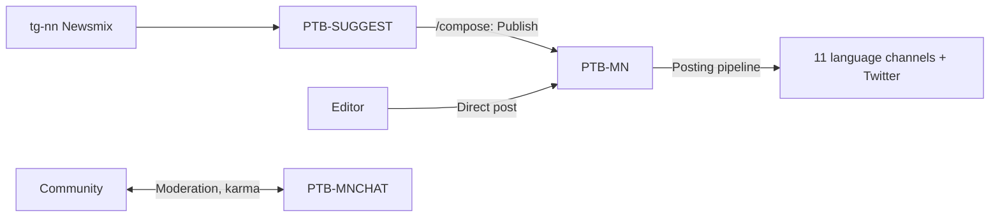

# 🔰 MilitärNews Bot Suite — User Guide

This guide is for editors, admins and members of the MilitärNews community. It describes how the three Telegram bots are used in day-to-day operation. Each bot has its own page, built in the same way as the tried-and-tested PTB-MN editor's handbook: core concepts, pipeline and workflow, commands, best practices and troubleshooting.

## How the bots work together

PTB-SUGGEST prepares candidates editorially and schedules them in the PTB-MN queue; from there, PTB-MN takes over the actual multilingual distribution. PTB-MNCHAT is independent of that and looks after the community group.

## Which page is right for whom?

- **You are an editor and post straight to the channel?** → [PTB-MN](ptb-mn.md), sections 1–3.
- **You write AI-assisted articles from raw material?** → [PTB-SUGGEST](ptb-suggest.md).
- **You moderate the community group or answer user questions there?** → [PTB-MNCHAT](ptb-mnchat.md).
