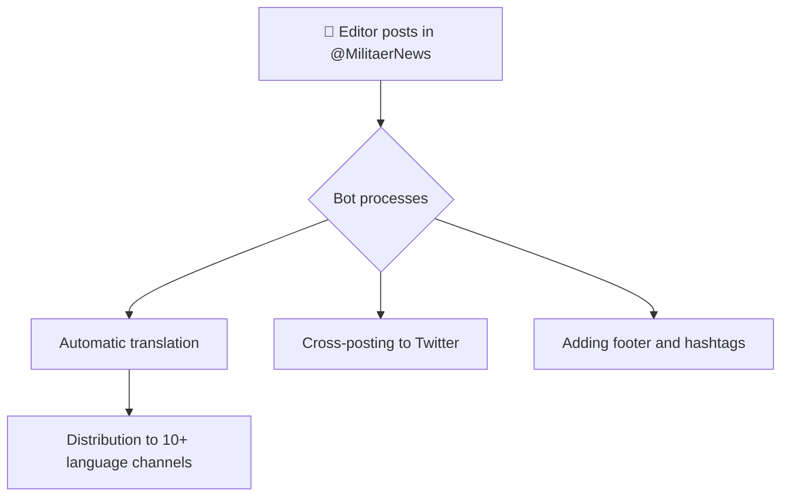

# 🔰 PTB-MN — Posting Pipeline Bot

The editor's handbook for the **PTB-MN bot**, the heart of news distribution in the MilitärNews system. It automates posting and editing content in the MilitärNews channels and synchronises it across multiple language channels.

## 1. Core concepts: post, content and footer

Every item we publish is called a **post**. A post has two main components:

- **Content**: the actual content (text, image, video) that you create as an editor — the only thing you need to send yourself.
- **Footer**: a block of text added automatically by the bot, with hashtags (derived from the flag emojis in the content) and a call to subscribe to the channel.

### Captions and media groups

- **Caption**: the text under a piece of media (image, video). Telegram limit: **1,024 characters**. Since the footer is appended automatically, keep the content to around **900 characters** ([character counter](https://www.charactercountonline.com/)).
- **Media group (album)**: when several pieces of media are sent at once, Telegram creates a media group (several messages with the same `mediagroup_id`). The bot waits a few seconds to make sure it has captured all parts before processing the post.

**Important:** for media groups, only the caption of the **first** item is used for translation and forwarding. Other captions are only visible if a user actively swipes through the album.

## 2. The posting pipeline: from German to the world

All content is first published in the German-language channel **[@MilitaerNews](https://t.me/militaernews)** and distributed automatically from there.

### Supported channels

| Language      | Channel | Telegram                                         | Twitter                                 |
| ------------- | ------- | ------------------------------------------------ | --------------------------------------- |
| 🇩🇪 German     | TG_DE   | [@MilitaerNews](https://t.me/militaernews)       | [German](https://x.com/MilitaerNews)    |
| 🇺🇸 English    | TG_EN   | [@MilitaryNewsEN](https://t.me/MilitaryNewsEN)   | [English](https://x.com/MilitaryNewsEN) |
| 🇹🇷 Turkish    | TG_TR   | [@MilitaryNewsTR](https://t.me/MilitaryNewsTR)   | -                                       |
| 🇮🇷 Persian    | TG_FA   | [@MilitaryNewsFA](https://t.me/MilitaryNewsFA)   | -                                       |
| 🇷🇺 Russian    | TG_RU   | [@MilitaryNewsRU](https://t.me/MilitaryNewsRU)   | -                                       |
| 🇧🇷 Portuguese | TG_PT   | [@MilitaryNewsBR](https://t.me/MilitaryNewsBR)   | -                                       |
| 🇪🇸 Spanish    | TG_ES   | [@MilitaryNewsES](https://t.me/MilitaryNewsES)   | -                                       |
| 🇫🇷 French     | TG_FR   | [@MilitaryNewsFR](https://t.me/MilitaryNewsFR)   | -                                       |
| 🇮🇹 Italian    | TG_IT   | [@MilitaryNewsITA](https://t.me/MilitaryNewsITA) | -                                       |
| 🇪🇬 Arabic     | TG_AR   | [@MilitaryNewsAR](https://t.me/MilitaryNewsAR)   | -                                       |
| 🇮🇩 Indonesian | TG_ID   | [@MilitaryNewsIDN](https://t.me/MilitaryNewsIDN) | -                                       |

The pipeline runs step by step: for a Twitter post, all media from TG_DE must first be downloaded and then uploaded again. Depending on size and number, this can take a while — which is why the footer and hashtags only appear in TG_DE once the whole run is finished.

## 3. Workflows for editors

### Standard post (text or media)

1. **Create the content**: write the text or select the media.
2. **Put flag emojis first**: at the beginning of the text, add the flag emojis of the countries involved. The bot generates the hashtags from them automatically.
3. **Post**: send the item to **[@MilitaerNews](https://t.me/militaernews)**.

The bot takes care of the rest: translation, footer, hashtags and distribution.

### Editing a message

1. Edit the post in **@MilitaerNews**.
2. **Important**: remove the entire footer added by the bot (divider line, hashtags, subscribe prompt).
3. Save the edit.

The bot detects the change by the missing footer and triggers an update in all language channels. It then adds the footer back in TG_DE.

- City names are **not** corrected automatically when editing.
- Twitter posts **cannot** be edited after publishing.
- For a media group, edit only the message with the caption.

### Special formats

| Hashtag       | Effect                                                                                                             |
| ------------- | ------------------------------------------------------------------------------------------------------------------ |
| `#eilmeldung` | The original message is removed and the text is re-posted as a caption under a standardised "breaking news" image. |
| `#mitteilung` | Like breaking news, but with a "statement" image; the post is additionally pinned in all channels.                 |
| `#werbung`    | Marks a post as an advert and distributes it accordingly.                                                          |

### Content guidelines

- Content starts with the flags of the countries the text is about.
- The footer can get quite long when there are many flag emojis, so stick to roughly 900 characters even for breaking news.
- We avoid content that could violate [Telegram's terms of service](https://telegram.org/tos). It can lead to reports from users and, in the worst case, to the channel being blocked.
- Replies to earlier posts are carried over into the other language channels.

## 4. Admin bot commands

In addition to the channel pipeline, the bot offers private admin commands (editors/admins only, sent as a direct message to the bot):

| Command              | Purpose                                                                                                                                                       |
| -------------------- | ------------------------------------------------------------------------------------------------------------------------------------------------------------- |
| `/ai_post`           | Collects texts/media you send; `/done` has AI turn them into a finished post, `/cancel` aborts.                                                               |
| `/synthesize`        | Collects several message snippets (text/image/video); `/done` uses AI to combine them into one post, then review with publish/edit/discard; `/cancel` aborts. |
| `/add_advertisement` | Guided dialogue for creating an advertising post (media or `/skip` → text → button text or `/skip` → URL → `/save`), `/cancel` aborts.                        |
| `/promo`             | Starts a referral promo campaign.                                                                                                                             |
| `/clear_promo`       | Resets all running promo campaigns.                                                                                                                           |

## 5. Best practices and troubleshooting

### ✅ Recommended

- **Respect the character limit**: plan conservatively with around 900 characters for the caption.
- **Flags instead of hashtags**: rely on automatic hashtag generation from flag emojis; don't add hashtags manually.
- **Be patient with albums**: media groups need more processing time — wait until the process has fully finished.
- **Post first, format later**: send the post unformatted first and only then format it in TG_DE (bold, links) to avoid translation errors.

### ❌ To avoid

- **Manual hashtags** — they interfere with the bot's workflow.
- **Editing with the footer still there** — without removing the footer, changes are **not** carried over to the other channels.
- **Impatience** — large media and albums need time for upload and processing.

### Troubleshooting

- **Post not being forwarded?**
  - Was the footer removed during the edit?
  - Is it a large file or an album? Wait a few minutes.
- **Formatting wrong in other languages?**
  - A known issue with machine translation. The symbol `║` is a placeholder for formatting that could not be carried over — it can be ignored.

## 6. Useful tools

- **Chart creation**: [chart-mn.vercel.app](https://chart-mn.vercel.app/)
- **Map creation**: [geo-mn.vercel.app](https://geo-mn.vercel.app/)
- **Source overview**: [mix-sv.vercel.app](https://mix-sv.vercel.app/)
- **Character counter**: [CharacterCountOnline.com](https://www.charactercountonline.com/)
- **Telegram limits**: [limits.tginfo.me](https://limits.tginfo.me/de-DE)
