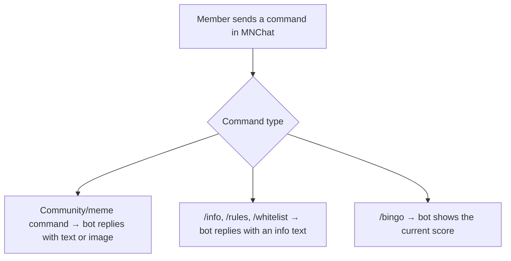

# 💬 PTB-MNCHAT — Community and Moderation Bot

The handbook for **PTB-MNCHAT**, which manages the MilitärNews community group (MNChat). It provides moderation tools, karma tracking and safety features.

## 1. Core concepts: messages, karma and the log chat

Every message in MNChat is the basis for two things:

- **Statistics**: for each user, the bot keeps the number of messages, words and characters in the `user_stats` table. Averages (words per message, length per message) are calculated from this.
- **Karma**: reputation that results from other users' reactions to your messages.

With `/info` (optionally as a reply to another message), the bot shows a user's karma, message count, averages, warnings and join date.

If the environment variable `PROTOCOL_CHAT` is set, the bot also logs to a separate log chat: joins/leaves, admin actions (`/warn`, `/unwarn`, `/ban` as well as native Telegram actions), including the message an action referred to.

## 2. Commands for all members

When a command is sent as a reply to another user's message, the bot replies to that user directly.

| Command                                                                                                              | Response                                                                                               |
| -------------------------------------------------------------------------------------------------------------------- | ------------------------------------------------------------------------------------------------------ |
| `/cmd` (or `/start`)                                                                                                 | Shows this command overview.                                                                           |
| `/rules`                                                                                                             | Shows the group rules.                                                                                 |
| `/whitelist`                                                                                                         | Lists the link domains allowed in the group.                                                           |
| `/info`                                                                                                              | Shows karma, message count, averages, warnings and join date (optionally as a reply to another user).  |
| `/bingo`                                                                                                             | Shows the current score of the bullshit bingo game.                                                    |
| `/maps`                                                                                                              | A list of current maps of Russia's war of aggression against Ukraine.                                  |
| `/loss`                                                                                                              | Databases of equipment losses in Ukraine.                                                              |
| `/donbas`                                                                                                            | Why Ukraine did not murder 14,000 civilians in the Donbas from 2014 onwards.                           |
| `/genozid`                                                                                                           | There was never a genocide of Ukrainians in the Donbas.                                                |
| `/short`                                                                                                             | List of abbreviations.                                                                                 |
| `/peace`                                                                                                             | Overview of Russian wars.                                                                              |
| `/bias`                                                                                                              | Where MN stands on neutrality.                                                                         |
| `/sofa`, `/bot`, `/mimimi`, `/maul`, `/duden`, `/argu`, `/vs`, `/disso`, `/front`, `/deutsch`, `/wissen`, `/hominem` | Meme/reaction images for recurring discussion patterns (trolling, whataboutism, weak arguments, etc.). |
| `/fact`                                                                                                              | Only available in the German chat.                                                                     |

## 3. Safety and moderation features

### Captcha on joining

New members have to solve an image captcha after joining (tap four correct symbols) before admins finally check their profile. This is fully automatic — no command needed.

### Link whitelist

Only links from a fixed list of domains (`/whitelist`) are allowed; all other links are **deleted automatically** to protect users from scams.

### Bullshit bingo

`/bingo` shows the current board with recurring discussion buzzwords (e.g. "wonder weapon", "denazification", "bio lab"). As soon as a row of recognised terms comes up, the group "wins" a round.

## 4. Commands for admins

Commands marked with `*` need either a reply to the target user's message **or** a user ID as an argument.

| Command                                | Purpose                                                          |
| -------------------------------------- | ---------------------------------------------------------------- |
| `/warn`*                               | Warn a user.                                                     |
| `/unwarn`*                             | Remove a warning.                                                |
| `/ban`*                                | Ban a user.                                                      |
| `/report`*                             | Report a user to the Tartaros anti-spam system.                  |
| `/reset_bingo`                         | Reset the bingo board.                                           |
| `/whitelist_admin`                     | Open whitelist management.                                       |
| `/add_whitelist` / `/remove_whitelist` | Add/remove a domain to/from the link whitelist.                  |
| `/add_advertisement`                   | Guided dialogue for creating an advertising post (as in PTB-MN). |
| `/promo` / `/clear_promo`              | Start or reset a referral promo campaign.                        |

## 5. Best practices and troubleshooting

### ✅ Recommended

- **Link `/rules`** instead of repeating the rules by hand when a newcomer asks.
- **Point to `/info`** when users ask about their karma or statistics.
- **Report instead of taking the law into your own hands**: on rule violations, reply with `@Redaktion` or, as an admin, use `/report` or `/warn` instead of escalating yourself.
- **Document warnings**: admins should use `/warn` as a reply to the offending message wherever possible, so it remains traceable in the log chat.

### ❌ To avoid

- **Posting links that are not whitelisted** — they are removed automatically.
- **Ignoring the captcha** — without solving it, access to the group stays restricted.
- **`/ban` without a prior warning** for violations that would only justify a warning (escalation: three warnings → restriction/ban).

### Troubleshooting

- **My message was deleted?** It probably contained a link not listed in `/whitelist`.
- **Stuck at the captcha?** All four correct symbols must be active at the same time — toggle the selection again if necessary.
- **`/warn` or `/ban` not working?** The command needs either a reply to the target user or their user ID as an argument, and only works for admins.

## 6. Useful tools

- **Group rules**: `/rules` directly in the chat.
- **Check allowed links**: `/whitelist` directly in the chat.
- **Source overview**: [mix-sv.vercel.app](https://mix-sv.vercel.app/)
