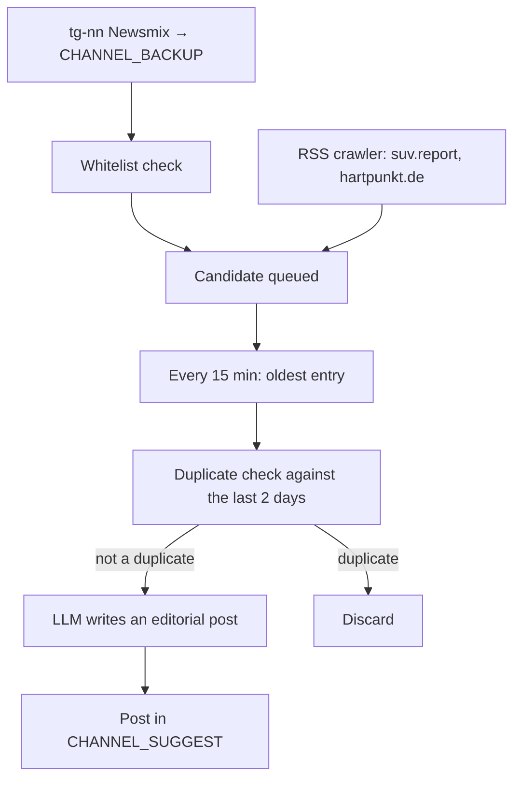

# 🧠 PTB-SUGGEST — Aggregation and AI Editorial Assistant

The handbook for **PTB-SUGGEST**, specialised in aggregating news from several sources (tg-nn Newsmix, suv.report, hartpunkt.de) and writing editorial posts for the Suggest channel with AI assistance.

## 1. Core concepts: queue, candidate and suggest post

Unlike PTB-MN, PTB-SUGGEST does not post what an editor writes directly. Instead, it collects **candidates** in a queue and publishes finished **suggest posts** from it automatically or with AI assistance:

- **Candidate**: a raw news excerpt from a source (Newsmix backup channel or RSS crawler), queued in the `suggest_posts` table.
- **Whitelisting**: only candidates from the monitored `CHANNEL_BACKUP` (where the tg-nn collector/processor forwards to) that are rated as relevant are queued.
- **Suggest post**: the finished article, written by AI in a lightly military-analytical tone, which appears in the Suggest channel.
- **Duplicate detection**: candidates too similar to posts already published in the last two days are discarded instead of being posted again.

## 2. The aggregation pipeline

- **Newsmix integration**: monitors `CHANNEL_BACKUP`, queues whitelisted posts — does not post anything itself.
- **RSS crawler**: additionally fetches the full article text from suv.report/hartpunkt.de (from `content:encoded` or, if necessary, from the article page), runs it through the same LLM pipeline (title, flags, military-analytical tone) and posts **at most one** new article per tick.
- **Scheduled publishing**: no bulk posting — exactly one queue entry is processed and published every 15 minutes.

## 3. Workflows for editors

All of the following commands work only in the **private direct message** to the bot, not in the channel.

### Getting started

`/start` or `/apps` show a command overview and keyboard buttons for opening the mini apps:

| Command  | Purpose                                                               |
| -------- | --------------------------------------------------------------------- |
| `/chart` | Opens the **chart-sv** mini app for creating charts.                  |
| `/map`   | Opens the **geo-sv** mini app for creating maps/geolocation graphics. |
| `/apps`  | Opens both mini apps to choose from.                                  |

**Chart/map workflow**: open the mini app → put together the chart/map → tap the screenshot/download button in the editor (client-side via html2canvas-pro, no server rendering) → send the downloaded image back to the chat manually.

### AI synthesis of a post (`/synthesize`)

1. `/synthesize` starts the assistant.
2. Send any number of text, image or video snippets as individual messages — they are collected.
3. `/done` triggers the LLM summary: the snippets are combined into a single editorial article (title, flags, tone to match the Suggest channel).
4. Review step: **Publish**, **Edit** or **Discard** using the buttons shown.
5. `/cancel` aborts the process at any time.

### Editorial Workbench (`/compose`)

For articles already in the queue or drafted:

1. `/compose` opens the workbench for the current article.
2. View the **preview**, **edit the text** (free text as a reply), **publish** (with confirmation) or **discard**.
3. `/cancel` ends the workbench session.

An article published via `/compose` is scheduled for the next free time slot of the GERMAN channel in PTB-MN.

## 4. Best practices and troubleshooting

### ✅ Recommended

- **Use `/synthesize` for raw material** and `/compose` for already drafted or queued articles — don't mix them up.
- **Collect all source snippets before `/done`**: only run `/done` once all texts/media have been sent — later additions start a new synthesis run.
- **Check the preview before publishing**: proofread AI-written articles for facts and tone before confirming.
- **Be patient with the mini apps**: wait for the screenshot button before sending the image back.

### ❌ To avoid

- **Sending new snippets during the review step** by accident — this automatically starts a new synthesis with the new snippet and discards the current draft.
- **Expecting bulk posts**: the Suggest channel deliberately posts only one article every 15 minutes, not a mass of posts.
- **Submitting candidates twice**: similar posts from the last two days are discarded automatically anyway — no need to have the same content synthesised repeatedly.

### Troubleshooting

- **No new post in the Suggest channel?** The pipeline only processes one entry every 15 minutes — wait briefly, or check whether the candidate was discarded as a duplicate.
- **`/synthesize` not behaving as expected?** Check whether a previous session is still open (send `/cancel`, then start again).
- **Image from chart-sv/geo-sv not arriving?** There is no server rendering — after downloading in the mini app, the image must be sent to the chat manually.

## 5. Useful tools

- **Chart creation**: [chart-mn.vercel.app](https://chart-mn.vercel.app/) (default URL, configurable via `CHART_WEBAPP_URL`)
- **Map creation**: [geo-mn.vercel.app](https://geo-mn.vercel.app/) (default URL, configurable via `GEO_WEBAPP_URL`)
- **Source overview**: [mix-sv.vercel.app](https://mix-sv.vercel.app/)
- **Character counter**: [CharacterCountOnline.com](https://www.charactercountonline.com/)
