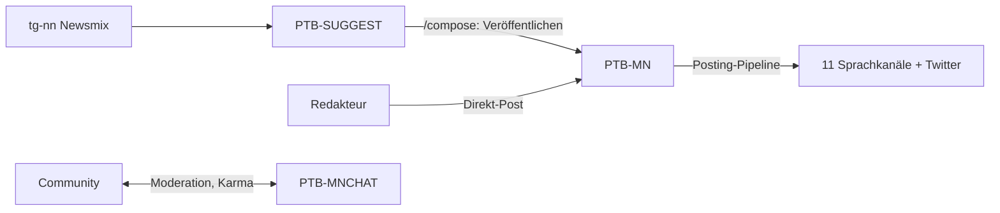

# 🔰 MilitärNews Bot-Suite — Nutzungsanleitung

Diese Anleitung richtet sich an Redakteure, Admins und Mitglieder der MilitärNews-Community und beschreibt, wie die drei Telegram-Bots im täglichen Betrieb genutzt werden. Jeder Bot hat seine eigene Seite, aufgebaut nach demselben Schema wie das bewährte PTB-MN-Redakteurshandbuch: Grundkonzepte, Pipeline/Workflow, Befehle, Best Practices und Troubleshooting.

## Wie die Bots zusammenspielen

PTB-SUGGEST bereitet Kandidaten redaktionell auf und reiht sie in den PTB-MN-Zeitplan ein; PTB-MN übernimmt ab dort die eigentliche mehrsprachige Verteilung. PTB-MNCHAT ist unabhängig davon für die Community-Gruppe zuständig.

## Für wen ist welche Seite relevant?

- **Nur Redakteur, postest direkt im Kanal?** → [PTB-MN](ptb-mn.md), Abschnitt 1–3.
- **Erstellst du KI-gestützt Artikel aus Rohmaterial?** → [PTB-SUGGEST](ptb-suggest.md).
- **Moderierst du die Community-Gruppe oder beantwortest Nutzerfragen dort?** → [PTB-MNCHAT](ptb-mnchat.md).
