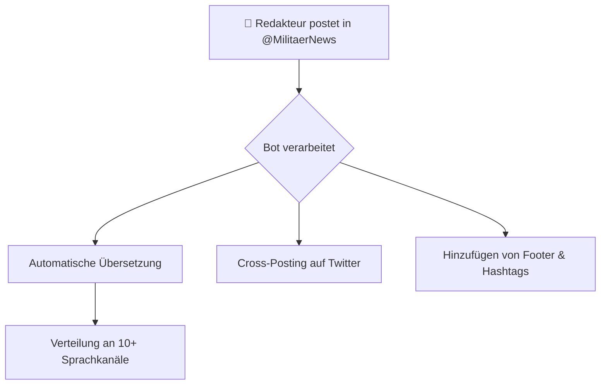

# 🔰 PTB-MN — Posting-Pipeline-Bot

Redakteurs-Handbuch für den **PTB-MN Bot**, das Herzstück der Nachrichtenverbreitung im MilitärNews-System. Er automatisiert das Posten und Editieren von Inhalten in den MilitärNews-Kanälen und synchronisiert sie über mehrere Sprachkanäle hinweg.

## 1. Grundkonzepte: Post, Content & Footer

Jeder Beitrag, den wir veröffentlichen, wird als **Post** bezeichnet. Ein Post setzt sich aus zwei Hauptkomponenten zusammen:

- **Content**: Der eigentliche Inhalt (Text, Bild, Video), den du als Redakteur erstellst — das Einzige, was du selbst mitsenden musst.
- **Footer**: Ein automatisch vom Bot hinzugefügter Textblock mit Hashtags (aus den Flaggen-Emojis im Content abgeleitet) und einer Aufforderung, den Kanal zu abonnieren.

### Caption und Mediengruppen

- **Caption**: Der Text unter einem Medium (Bild, Video). Telegram-Limit: **1024 Zeichen**. Da der Footer automatisch angehängt wird, den Content auf ca. **900 Zeichen** begrenzen ([Zeichenzähler](https://www.charactercountonline.com/)).
- **Mediengruppe (Album)**: Werden mehrere Medien gleichzeitig gesendet, erstellt Telegram eine Mediengruppe (mehrere Nachrichten mit derselben `mediagroup_id`). Der Bot wartet einige Sekunden, um sicherzustellen, dass alle Teile erfasst sind, bevor er den Post weiterverarbeitet.

**Wichtig:** Bei Mediengruppen wird nur die Caption des **ersten** Mediums für Übersetzung und Weiterleitung verwendet. Weitere Captions sind nur sichtbar, wenn ein Nutzer aktiv durch das Album wischt.

## 2. Die Posting-Pipeline: Von Deutsch in die Welt

Alle Inhalte werden zuerst im deutschsprachigen Kanal **[@MilitaerNews](https://t.me/militaernews)** veröffentlicht und von dort automatisch weiterverteilt.

### Unterstützte Kanäle

| Sprache          | Kanal | Telegram                                         | Twitter                                  |
| ---------------- | ----- | ------------------------------------------------ | ---------------------------------------- |
| 🇩🇪 Deutsch       | TG_DE | [@MilitaerNews](https://t.me/militaernews)       | [Deutsch](https://x.com/MilitaerNews)    |
| 🇺🇸 Englisch      | TG_EN | [@MilitaryNewsEN](https://t.me/MilitaryNewsEN)   | [Englisch](https://x.com/MilitaryNewsEN) |
| 🇹🇷 Türkisch      | TG_TR | [@MilitaryNewsTR](https://t.me/MilitaryNewsTR)   | -                                        |
| 🇮🇷 Persisch      | TG_FA | [@MilitaryNewsFA](https://t.me/MilitaryNewsFA)   | -                                        |
| 🇷🇺 Russisch      | TG_RU | [@MilitaryNewsRU](https://t.me/MilitaryNewsRU)   | -                                        |
| 🇧🇷 Portugiesisch | TG_PT | [@MilitaryNewsBR](https://t.me/MilitaryNewsBR)   | -                                        |
| 🇪🇸 Spanisch      | TG_ES | [@MilitaryNewsES](https://t.me/MilitaryNewsES)   | -                                        |
| 🇫🇷 Französisch   | TG_FR | [@MilitaryNewsFR](https://t.me/MilitaryNewsFR)   | -                                        |
| 🇮🇹 Italienisch   | TG_IT | [@MilitaryNewsITA](https://t.me/MilitaryNewsITA) | -                                        |
| 🇪🇬 Arabisch      | TG_AR | [@MilitaryNewsAR](https://t.me/MilitaryNewsAR)   | -                                        |
| 🇮🇩 Indonesisch   | TG_ID | [@MilitaryNewsIDN](https://t.me/MilitaryNewsIDN) | -                                        |

Die Pipeline läuft Schritt für Schritt: Für einen Twitter-Post müssen alle Medien aus TG_DE erst heruntergeladen und dann hochgeladen werden. Je nach Größe und Anzahl kann das dauern — Footer und Hashtags erscheinen in TG_DE deshalb erst, wenn der gesamte Durchlauf fertig ist.

## 3. Workflows für Redakteure

### Standard-Post (Text oder Medien)

1. **Inhalt erstellen**: Text verfassen oder Medien auswählen.
2. **Flaggen-Emojis voranstellen**: Am Anfang des Textes die Flaggen-Emojis der betroffenen Länder einfügen. Der Bot generiert daraus automatisch die Hashtags.
3. **Posten**: Beitrag in **[@MilitaerNews](https://t.me/militaernews)** senden.

Der Bot übernimmt den Rest: Übersetzung, Footer, Hashtags, Verteilung.

### Nachricht bearbeiten

1. Post in **@MilitaerNews** bearbeiten.
2. **Wichtig**: Den gesamten vom Bot hinzugefügten Footer (Trennlinie, Hashtags, Abo-Hinweis) entfernen.
3. Bearbeitung speichern.

Der Bot erkennt die Änderung am fehlenden Footer und stößt die Aktualisierung in allen Sprachkanälen an. Anschließend fügt er den Footer in TG_DE wieder hinzu.

- Städtenamen werden beim Editieren **nicht** automatisch korrigiert.
- Twitter-Posts können **nicht** nachträglich bearbeitet werden.
- Bei einer Mediengruppe nur die Nachricht mit der Caption editieren.

### Sonderformate

| Hashtag       | Wirkung                                                                                                              |
| ------------- | -------------------------------------------------------------------------------------------------------------------- |
| `#eilmeldung` | Ursprüngliche Nachricht wird entfernt, Text als Caption unter einem standardisierten „Eilmeldung"-Bild neu gepostet. |
| `#mitteilung` | Wie Eilmeldung, aber mit „Mitteilung"-Bild; der Post wird zusätzlich in allen Kanälen angepinnt.                     |
| `#werbung`    | Kennzeichnet einen Beitrag als Werbung und verteilt ihn entsprechend.                                                |

### Content-Richtlinien

- Der Content beginnt mit den Flaggen der Länder, um die es im folgenden Text geht.
- Der Footer kann bei vielen Flaggen-Emojis recht lang werden. Deshalb die rund 900 Zeichen auch bei Eilmeldungen einhalten.
- Inhalte, die gegen die [Nutzungsbedingungen von Telegram](https://telegram.org/tos/de) verstoßen könnten, vermeiden wir. Sie können zu Meldungen durch Nutzer und im Zweifel zur Sperrung des Kanals führen.
- Antworten (Replies) auf frühere Posts werden in die anderen Sprachkanäle übernommen.

## 4. Admin-Bot-Befehle

Zusätzlich zur reinen Kanal-Pipeline bietet der Bot private Admin-Befehle (nur für Redaktion/Admins, per Direktnachricht an den Bot):

| Befehl               | Zweck                                                                                                                                                                                  |
| -------------------- | -------------------------------------------------------------------------------------------------------------------------------------------------------------------------------------- |
| `/ai_post`           | Sammelt gesendete Texte/Medien, `/done` lässt eine KI daraus einen fertig formulierten Post erstellen, `/cancel` bricht ab.                                                            |
| `/synthesize`        | Sammelt mehrere Nachrichten-Schnipsel (Text/Bild/Video), `/done` fasst sie per KI zu einem Post zusammen, danach Review mit Veröffentlichen/Bearbeiten/Verwerfen; `/cancel` bricht ab. |
| `/add_advertisement` | Geführter Dialog zum Anlegen eines Werbe-Posts (Medium oder `/skip` → Text → Button-Text oder `/skip` → URL → `/save`), `/cancel` bricht ab.                                           |
| `/promo`             | Startet eine Referral-Promo-Aktion.                                                                                                                                                    |
| `/clear_promo`       | Setzt alle laufenden Promo-Aktionen zurück.                                                                                                                                            |

## 5. Best Practices & Fehlerbehebung

### ✅ Empfohlenes Vorgehen

- **Zeichenlimit einhalten**: Konservativ mit ~900 Zeichen für die Caption planen.
- **Flaggen statt Hashtags**: Auf die automatische Hashtag-Generierung durch Flaggen-Emojis verlassen, keine manuellen Hashtags hinzufügen.
- **Geduld bei Alben**: Mediengruppen brauchen mehr Verarbeitungszeit — abwarten, bis der Prozess vollständig abgeschlossen ist.
- **Erst posten, dann formatieren**: Post zunächst unformatiert senden und erst danach in TG_DE formatieren (Fettung, Links), um Übersetzungsfehler zu vermeiden.

### ❌ Zu vermeiden

- **Manuelle Hashtags** — stören den Bot-Workflow.
- **Bearbeitung mit Footer** — ohne Entfernen des Footers werden Änderungen **nicht** in andere Kanäle übernommen.
- **Ungeduld** — große Medien und Alben brauchen Zeit für Upload und Verarbeitung.

### Troubleshooting

- **Post wird nicht weitergeleitet?**
  - Wurde bei der Bearbeitung der Footer entfernt?
  - Handelt es sich um eine große Datei oder ein Album? Einige Minuten abwarten.
- **Formatierung in anderen Sprachen fehlerhaft?**
  - Bekanntes Problem der maschinellen Übersetzung. Das Symbol `║` ist ein Platzhalter für nicht übertragbare Formatierung — kann ignoriert werden.

## 6. Nützliche Tools

- **Chart-Erstellung**: [chart-mn.vercel.app](https://chart-mn.vercel.app/)
- **Karten-Erstellung**: [geo-mn.vercel.app](https://geo-mn.vercel.app/)
- **Quellen-Übersicht**: [mix-sv.vercel.app](https://mix-sv.vercel.app/)
- **Zeichenzähler**: [CharacterCountOnline.com](https://www.charactercountonline.com/)
- **Telegram-Limits**: [limits.tginfo.me](https://limits.tginfo.me/de-DE)
