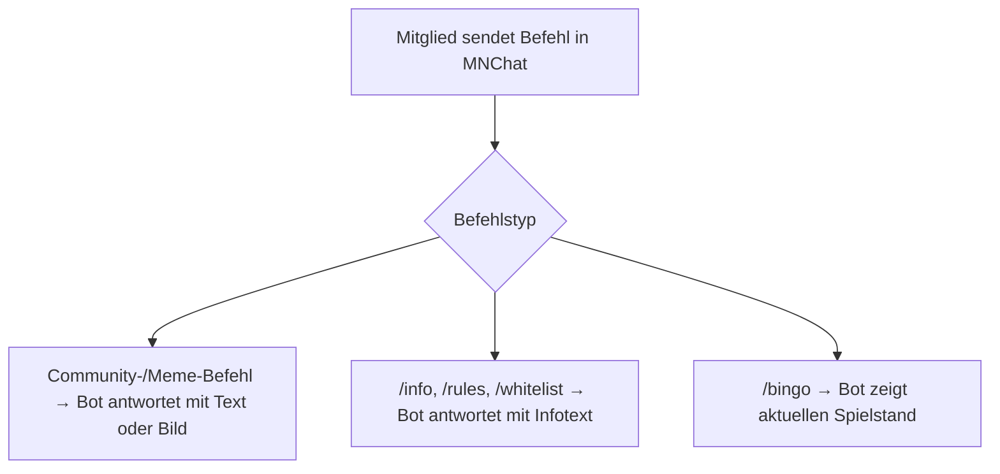

# 💬 PTB-MNCHAT — Community- & Moderations-Bot

Handbuch für **PTB-MNCHAT**, zuständig für die Verwaltung der MilitärNews-Community-Gruppe (MNChat). Er bietet Moderationswerkzeuge, Karma-Tracking und Sicherheitsfunktionen.

## 1. Grundkonzepte: Nachricht, Karma & Log-Chat

Jede Nachricht in MNChat ist Grundlage für zwei Dinge:

- **Statistik**: Für jeden Nutzer führt der Bot in der Tabelle `user_stats` Nachrichtenanzahl, Wortanzahl und Zeichenlänge mit. Daraus werden Durchschnittswerte (Wörter/Nachricht, Länge/Nachricht) berechnet.
- **Karma**: Reputation, die sich aus Reaktionen anderer Nutzer auf die eigenen Nachrichten ergibt.

Mit `/info` (optional als Reply auf eine andere Nachricht) zeigt der Bot Karma, Nachrichtenanzahl, Durchschnittswerte, Warnungen und Beitrittsdatum eines Nutzers an.

Ist die Umgebungsvariable `PROTOCOL_CHAT` gesetzt, protokolliert der Bot zusätzlich in einem separaten Log-Chat: Beitritte/Austritte, Admin-Aktionen (`/warn`, `/unwarn`, `/ban` sowie native Telegram-Aktionen) inklusive der Nachricht, auf die sich eine Aktion per Befehl bezog.

## 2. Befehle für alle Mitglieder

Wird ein Befehl als Reply auf die Nachricht eines anderen Nutzers gesendet, antwortet der Bot dem anderen Nutzer direkt.

| Befehl                                                                                                               | Antwort                                                                                                                       |
| -------------------------------------------------------------------------------------------------------------------- | ----------------------------------------------------------------------------------------------------------------------------- |
| `/cmd` (bzw. `/start`)                                                                                               | Zeigt diese Befehlsübersicht.                                                                                                 |
| `/rules`                                                                                                             | Zeigt die Gruppenregeln.                                                                                                      |
| `/whitelist`                                                                                                         | Listet die in der Gruppe erlaubten Link-Domains auf.                                                                          |
| `/info`                                                                                                              | Zeigt Karma, Nachrichtenzahl, Durchschnittswerte, Warnungen und Beitrittsdatum (optional als Reply auf einen anderen Nutzer). |
| `/bingo`                                                                                                             | Zeigt den aktuellen Spielstand des Bullshit-Bingo.                                                                            |
| `/maps`                                                                                                              | Liste aktueller Karten des russischen Angriffskriegs in der Ukraine.                                                          |
| `/loss`                                                                                                              | Datenbanken mit Materialverlusten in der Ukraine.                                                                             |
| `/donbas`                                                                                                            | Warum die Ukraine seit 2014 nicht 14.000 Zivilisten im Donbas ermordete.                                                      |
| `/genozid`                                                                                                           | Es gab nie einen Genozid der Ukrainer im Donbas.                                                                              |
| `/short`                                                                                                             | Abkürzungsverzeichnis.                                                                                                        |
| `/peace`                                                                                                             | Übersicht russischer Kriege.                                                                                                  |
| `/bias`                                                                                                              | Einordnung zur Neutralität von MN.                                                                                            |
| `/sofa`, `/bot`, `/mimimi`, `/maul`, `/duden`, `/argu`, `/vs`, `/disso`, `/front`, `/deutsch`, `/wissen`, `/hominem` | Meme-/Reaktionsbilder für wiederkehrende Diskussionsmuster (Trollerei, Whataboutism, schwache Argumente etc.).                |
| `/fact`                                                                                                              | Nur im deutschen Chat verfügbar.                                                                                              |

## 3. Sicherheits- und Moderationsfunktionen

### Captcha bei Beitritt

Neue Mitglieder müssen nach dem Beitritt ein Bild-Captcha lösen (4 richtige Symbole antippen), bevor Admins ihr Profil final prüfen. Das ist vollautomatisch — kein Befehl nötig.

### Link-Whitelist

Nur Links aus einer festgelegten Domain-Liste (`/whitelist`) sind erlaubt; alle anderen Links werden **automatisch gelöscht**, um Nutzer vor Scam-Versuchen zu schützen.

### Bullshit-Bingo

`/bingo` zeigt das aktuelle Spielfeld mit wiederkehrenden Diskussions-Buzzwords (z. B. „Wunderwaffe", „Entnazifizierung", „Biolabor"). Sobald eine Reihe erkannter Begriffe fällt, „gewinnt" die Gruppe eine Runde.

## 4. Befehle für Admins

Mit `*` markierte Befehle benötigen entweder eine Reply auf die Nachricht des Zielnutzers **oder** eine User-ID als Argument.

| Befehl                                 | Zweck                                                           |
| -------------------------------------- | --------------------------------------------------------------- |
| `/warn`*                               | Nutzer verwarnen.                                               |
| `/unwarn`*                             | Eine Warnung abziehen.                                          |
| `/ban`*                                | Nutzer sperren.                                                 |
| `/report`*                             | Nutzer bei Tartaros-Antispam melden.                            |
| `/reset_bingo`                         | Bingo-Spielfeld zurücksetzen.                                   |
| `/whitelist_admin`                     | Whitelist-Verwaltung öffnen.                                    |
| `/add_whitelist` / `/remove_whitelist` | Domain zur Link-Whitelist hinzufügen/entfernen.                 |
| `/add_advertisement`                   | Geführter Dialog zum Anlegen eines Werbe-Posts (wie in PTB-MN). |
| `/promo` / `/clear_promo`              | Referral-Promo-Aktion starten bzw. zurücksetzen.                |

## 5. Best Practices & Fehlerbehebung

### ✅ Empfohlenes Vorgehen

- **`/rules` verlinken** statt Regeln manuell zu wiederholen, wenn ein Neuling nachfragt.
- **Auf `/info` verweisen**, wenn Nutzer nach ihrem Karma oder ihrer Statistik fragen.
- **Meldung statt Selbstjustiz**: Bei Regelverstößen mit `@Redaktion` antworten oder als Admin `/report`/`/warn` nutzen, statt selbst zu eskalieren.
- **Warnungen dokumentieren**: Admins sollten `/warn` möglichst als Reply auf die auslösende Nachricht nutzen, damit sie im Log-Chat nachvollziehbar bleibt.

### ❌ Zu vermeiden

- **Nicht-whitelisted Links posten** — werden automatisch entfernt.
- **Captcha ignorieren** — ohne Lösen bleibt der Zugang zur Gruppe eingeschränkt.
- **`/ban` ohne vorherige Warnung** bei Verstößen, die eigentlich nur eine Verwarnung rechtfertigen (Eskalationsstufen: 3 Warnungen → Einschränkung/Sperre).

### Troubleshooting

- **Meine Nachricht wurde gelöscht?** Vermutlich enthielt sie einen nicht in `/whitelist` gelisteten Link.
- **Ich hänge im Captcha fest?** Alle 4 korrekten Symbole müssen gleichzeitig aktiv angetippt sein — Auswahl notfalls erneut umschalten.
- **`/warn` bzw. `/ban` wirkt nicht?** Der Befehl braucht entweder eine Reply auf den Zielnutzer oder dessen User-ID als Argument, und funktioniert nur für Admins.

## 6. Nützliche Tools

- **Regeln der Gruppe**: `/rules` direkt im Chat.
- **Erlaubte Links prüfen**: `/whitelist` direkt im Chat.
- **Quellen-Übersicht**: [mix-sv.vercel.app](https://mix-sv.vercel.app/)
