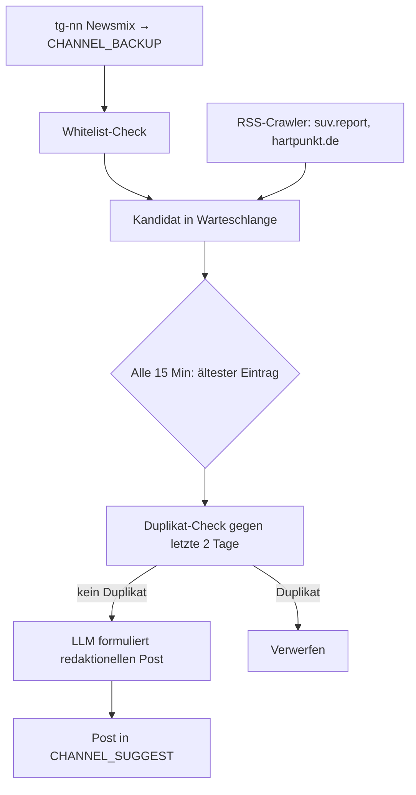

# 🧠 PTB-SUGGEST — Aggregation & KI-Redaktions-Assistent

Handbuch für **PTB-SUGGEST**, spezialisiert auf die Aggregation von Nachrichten aus mehreren Quellen (tg-nn Newsmix, suv.report, hartpunkt.de) und die KI-gestützte Erstellung redaktioneller Posts für den Suggest-Kanal.

## 1. Grundkonzepte: Warteschlange, Kandidat & Suggest-Post

Anders als PTB-MN postet PTB-SUGGEST nicht direkt, was ein Redakteur schreibt, sondern sammelt **Kandidaten** in einer Warteschlange und veröffentlicht daraus automatisch oder KI-gestützt fertige **Suggest-Posts**:

- **Kandidat**: Ein roher Nachrichten-Ausschnitt aus einer Quelle (Newsmix-Backup-Kanal oder RSS-Crawler), der in die Tabelle `suggest_posts` eingereiht wird.
- **Whitelisting**: Nur Kandidaten aus dem beobachteten `CHANNEL_BACKUP` (wohin der tg-nn Collector/Processor weiterleitet), die als relevant eingestuft sind, werden eingereiht.
- **Suggest-Post**: Der fertige, von einer KI im leicht militärisch-analytischen Ton formulierte Artikel, der im Suggest-Kanal erscheint.
- **Duplikat-Erkennung**: Kandidaten, die zu ähnlich zu einem der letzten 2 Tage bereits geposteten Beiträge sind, werden verworfen statt erneut gepostet.

## 2. Die Aggregations-Pipeline

- **Newsmix-Integration**: Beobachtet `CHANNEL_BACKUP`, reiht whitelisted Posts ein — postet selbst nichts.
- **RSS-Crawler**: Holt zusätzlich den vollständigen Artikeltext von suv.report/hartpunkt.de (aus `content:encoded` oder notfalls von der Artikelseite), formuliert ihn über dieselbe LLM-Pipeline (Titel, Flaggen, militärisch-analytischer Ton) und postet **maximal einen** neuen Artikel pro Tick.
- **Geplante Veröffentlichung**: Kein Bulk-Posting — alle 15 Minuten wird genau ein Warteschlangen-Eintrag verarbeitet und veröffentlicht.

## 3. Workflows für die Redaktion

Alle folgenden Befehle funktionieren nur in der **privaten Direktnachricht** an den Bot, nicht im Kanal.

### Einstieg

`/start` bzw. `/apps` zeigen eine Befehlsübersicht sowie Tastatur-Buttons, um die Mini-Apps zu öffnen:

| Befehl   | Zweck                                                                    |
| -------- | ------------------------------------------------------------------------ |
| `/chart` | Öffnet die Mini-App **chart-sv** zur Diagramm-Erstellung.                |
| `/map`   | Öffnet die Mini-App **geo-sv** zur Karten-/Geolokalisierungs-Erstellung. |
| `/apps`  | Öffnet beide Mini-Apps zur Auswahl.                                      |

**Ablauf für Chart/Karte**: Mini-App öffnen → Diagramm/Karte zusammenstellen → im Editor auf den Screenshot-/Download-Button tippen (client-seitig per html2canvas-pro, kein Server-Rendering) → das heruntergeladene Bild manuell zurück in den Chat schicken.

### KI-Synthese eines Posts (`/synthesize`)

1. `/synthesize` startet den Assistenten.
2. Beliebig viele Text-, Bild- oder Video-Schnipsel als einzelne Nachrichten senden — sie werden gesammelt.
3. `/done` löst die LLM-Zusammenfassung aus: Die Schnipsel werden zu einem einzigen redaktionellen Artikel (Titel, Flaggen, Ton passend zum Suggest-Kanal) zusammengefasst.
4. Review-Schritt: **Veröffentlichen**, **Bearbeiten** oder **Verwerfen** über die angezeigten Buttons.
5. `/cancel` bricht den Vorgang jederzeit ab.

### Editorial Workbench (`/compose`)

Für bereits in der Warteschlange liegende bzw. entworfene Artikel:

1. `/compose` öffnet die Workbench für den aktuellen Artikel.
2. **Vorschau** ansehen, **Text bearbeiten** (freier Text als Antwort), **Veröffentlichen** (mit Bestätigung) oder **Verwerfen**.
3. `/cancel` bricht die Workbench-Sitzung ab.

Ein per `/compose` veröffentlichter Artikel wird in den nächsten freien Zeitslot des GERMAN-Kanals von PTB-MN eingeplant.

## 4. Best Practices & Fehlerbehebung

### ✅ Empfohlenes Vorgehen

- **`/synthesize` für Rohmaterial**, `/compose` für bereits vorformulierte bzw. aus der Warteschlange stammende Artikel — nicht vermischen.
- **Alle Quellen-Schnipsel vor `/done` sammeln**: Erst wenn alle Texte/Medien gesendet wurden, `/done` ausführen — spätere Ergänzungen starten einen neuen Synthese-Durchlauf.
- **Vorschau vor Veröffentlichung prüfen**: KI-formulierte Artikel vor dem Bestätigen auf Fakten und Ton gegenlesen.
- **Bei Mini-Apps geduldig sein**: Screenshot-Button abwarten, bevor das Bild zurückgeschickt wird.

### ❌ Zu vermeiden

- **Neue Schnipsel im Review-Schritt senden**, ohne das zu wollen — das startet automatisch eine neue Synthese mit dem neuen Schnipsel und verwirft den bisherigen Entwurf.
- **Bulk-Erwartung**: Der Suggest-Kanal postet bewusst nur einen Artikel alle 15 Minuten, kein Massen-Posting.
- **Kandidaten doppelt einreichen**: Ähnliche Beiträge der letzten 2 Tage werden ohnehin automatisch verworfen — unnötig, denselben Inhalt mehrfach synthetisieren zu lassen.

### Troubleshooting

- **Kein neuer Post im Suggest-Kanal?** Die Pipeline verarbeitet nur alle 15 Minuten einen Eintrag — kurz abwarten, oder prüfen, ob der Kandidat als Duplikat verworfen wurde.
- **`/synthesize` reagiert nicht wie erwartet?** Prüfen, ob noch eine vorherige Sitzung offen ist (`/cancel` sendet, dann neu starten).
- **Bild aus chart-sv/geo-sv kommt nicht an?** Es gibt kein Server-Rendering — das Bild muss nach dem Download in der Mini-App manuell in den Chat geschickt werden.

## 5. Nützliche Tools

- **Chart-Erstellung**: [chart-mn.vercel.app](https://chart-mn.vercel.app/) (Standard-URL, per `CHART_WEBAPP_URL` konfigurierbar)
- **Karten-Erstellung**: [geo-mn.vercel.app](https://geo-mn.vercel.app/) (Standard-URL, per `GEO_WEBAPP_URL` konfigurierbar)
- **Quellen-Übersicht**: [mix-sv.vercel.app](https://mix-sv.vercel.app/)
- **Zeichenzähler**: [CharacterCountOnline.com](https://www.charactercountonline.com/)
